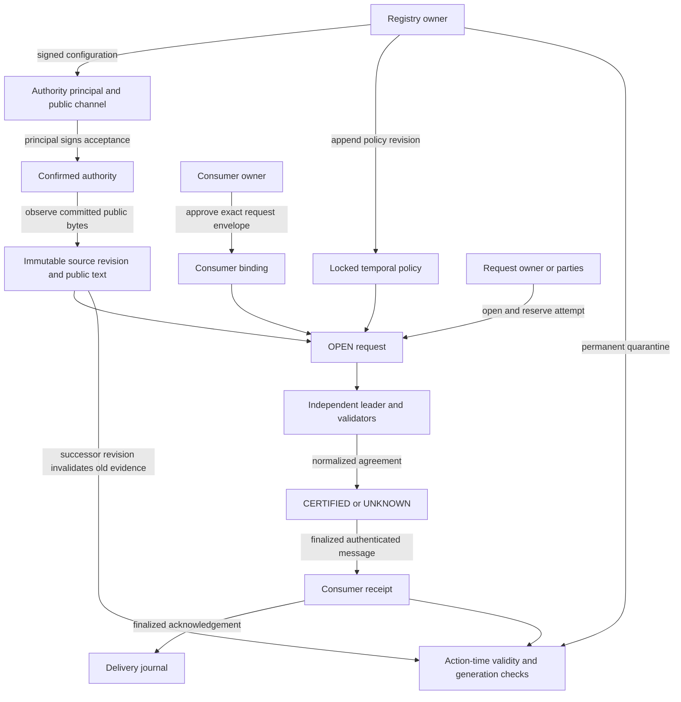
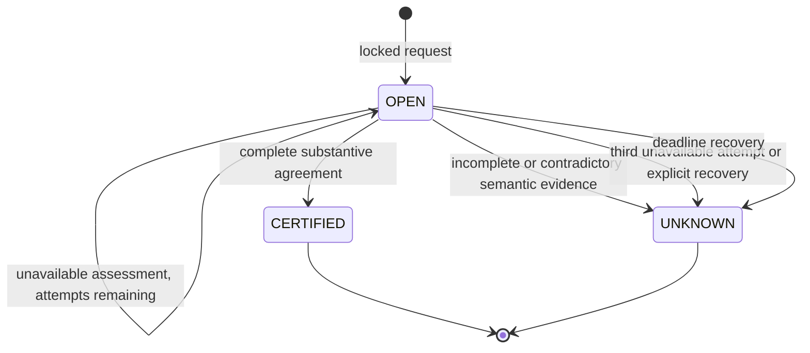

# Authority, storage and lifecycle

## State and authority diagram

Supersession and quarantine are independent validity overlays. They do not rewrite a terminal certificate. A subsequent source revision or request receives a new ID; the old data, certificate, delivery records and links remain available. `get_interval_certificate` returns current validity and supersession alongside the preserved certificate.

## Permissions

| Operation | Authorized signer |
| --- | --- |
| Authority and policy registration | Janus deployment owner |
| Authority acceptance and source observation | The configured principal |
| Consumer registration | That consumer contract, via its own owner-approved finalized message |
| Request creation | The owner specified in the exact currently consumer-approved envelope |
| Attempt reservation, assessment, timeout recovery and delivery | Request owner or locked parties |
| Quarantine | Janus deployment owner |
| Consumer request approval, unopened approval cancellation and action execution | That consumer's deployment owner |
| Certificate receipt | Janus contract address only |
| Delivery acknowledgement | The bound consumer contract address only |

Permission to assess never grants policy, authority, observation or consumer configuration rights. Principals cannot edit an observed revision. A request owner cannot replace a locked proposition, policy, manifest or consequence. Parties receive assessment and delivery permission only.

## Source trust assumptions

The registry owner audits and vouches for the authority configuration, its principal, scope and public channel. The principal explicitly accepts that configuration in a signed transaction. The `public_evidence_url` is an on-chain disclosure for governance and reviewers; the contract does not infer an organization-to-key relationship from that URL or fetch it as identity proof. Independent source fetches use the pinned deployment-owned transport, which enforces the configured HTTPS origin and directory prefix, rejects every redirect and returns only committed bytes. The transport is an explicit trust and availability dependency; [transport evidence](../evidence/source-transport.json) binds its deployed sources and live HTTP checks. The Node.js integration configures observer keys for Node.js public channels; it does not represent those keys as Node.js publisher accounts.

The authority owner is a real trust boundary. A malicious owner can approve an unreliable channel. A malicious principal can observe a false statement on an approved channel. Independent validators verify temporal meaning, committed bytes and witnesses under the configured policy; consensus cannot make a source's assertions true. Consumers explicitly agree to this provenance policy and fail closed on unresolved evidence.

The observation record publishes raw text, its SHA-256 commitment and the principal-approved manifest. It emits an authenticated self-callback on finalization. Only that callback sets transaction-time support, using its own conservatively rounded network creation time after the observation became final. A pending source is invalid and has no availability upper bound. The principal can retry confirmation up to three total finalized broadcasts. The bound does not depend on a webpage heading or a caller-supplied historical date. External source changes later cannot alter stored historical bytes; a subsequent assessment refetches and rejects changed bytes, while existing certificates continue to disclose their committed historical revision. A successor source observation must use a new ID and consecutive revision. Old source revisions become inactive immediately when the successor is observed.

## Storage layout

All persistent fields are class-level annotations. Records use `@allow_storage` dataclasses. `TreeMap` holds authorities, sources, policy revisions, requests, consumer configurations, delivery operations and quarantine reasons. Additional `TreeMap` indexes track policy heads, source heads, subject heads and consumer generations. Source revision heads use `(authority_id, source subject_id)`; request heads use `(consumer, application subject_id)`.

`DynArray[str]` history collections are bounded by constructor capacity, which is at most 10,000. Views paginate at most 50 IDs. Counters use `u8`, `u32` and `u64` with checked external integer bounds. UTC time uses integer seconds. Notice periods use integer seconds. There are no floating-point quantities or native wall-clock reads.

The supported transaction-time field is `gl.message_raw["datetime"]`. Fractional transaction timestamps are rounded upward to an inclusive observation upper bound. Deadline comparisons use that same conservative integer representation. Date roles are resolved semantically before deterministic parsing. Unsupported calendars, implicit timezones and invalid offsets cannot form certified intervals.

## Delivery and crash recovery

The resolver persists the certificate payload, operation ID, consumer, broadcast count and acknowledgement before emitting `receive_certificate(..., on="finalized")`. A synchronous certificate view is an inspection interface, not finality proof. The consumer accepts only authenticated messages from its bound resolver. The payload binds the resolver, consumer, operation ID and full request certificate. It verifies its previously approved envelope digest and the resolver's delivery journal, then checks current source and request validity.

Duplicate callbacks with identical payloads reuse the stored acknowledgement. Conflicting operation reuse fails. Reordered or stale callbacks are recorded as STALE and cannot replace a newer restriction. Approving a successor blocks the previous application state immediately. A current UNKNOWN certificate records BLOCKED and retains the unresolved status. The consumer sends a finalized `acknowledge` message back to the resolver. An old receipt cannot clear a pending or newer request. Execution is indexed by request generation and persists when another delivery ID is received. An unopened approval may be cancelled only by the consumer owner after checking the actual resolver request and subject head. Cancellation permanently revokes that ID and holds the restriction until a replacement at the cancelled generation is delivered.

Delivery broadcasts are limited to three. A journaled but unacknowledged operation can be retried while its evidence remains current. An acknowledgement is immutable except for identical repetition. `scripts/studio.py` journals each submission with its exact request binding and transaction hash before polling; interrupted processes resume by operation ID. It persists finalized parent and child receipts, binds cached evidence to the transaction hash, signer, destination and raw operation calldata, verifies deployment source bytes and emitted parent-child relationships, and rejects lifecycle success with execution failure.

The consumers implement no reservations of money or finite external capacity. Their capacity bounds are storage limits. An application adding scarce-resource holds must account for pending holds before acknowledgements and give only each reservation owner release permission.

## Revisions, revocation and upgrades

Policies append strictly consecutive revisions. Existing policy versions remain immutable. Source revisions append new IDs with a predecessor link; superseded sources invalidate all dependent requests at action time. Request generations are consecutive per consumer and subject. A successor requires its specified owner's signature, the predecessor ID and exact current consumer approval. Consumer approval may explicitly authorize owner rotation, including recovery after predecessor quarantine. Certificates preserve all locked bindings and their original terminal decision.

The owner can permanently quarantine an authority, source, policy version or request. The reason is a public digest retrievable with `get_quarantine_reason`. Quarantine does not erase prior evidence or silently restore permission. Reinstatement requires a new authority, policy, source or request binding. Consumers use BLOCK as the only supported unresolved consequence.

These deployments expose no upgrade entry point. Changes to an incompatible schema require a new deployment and explicit consumer rebinding. New fields for a compatible future storage layout must be appended at the end, with defaults that safely read zero or empty in old storage. Reordering fields is incompatible. A registered consumer cannot silently change its resolver policy or consequence configuration.
